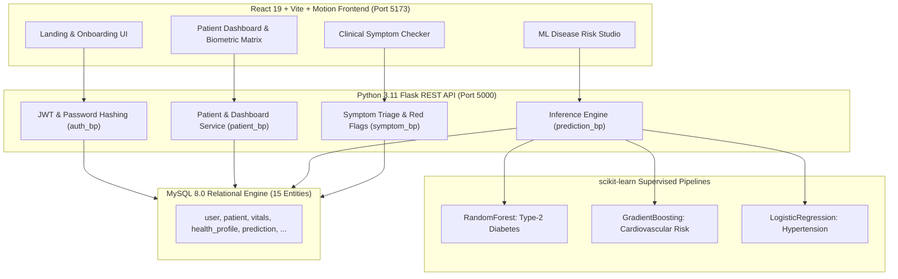

# CarePulse — Healthcare Management & Disease Risk Prediction System

CarePulse is a full-stack clinical DBMS and preventative healthcare web platform designed for clinical vitals management, longitudinal biometric tracking, and supervised disease risk stratification.

---

## 1. System Architecture



---

## 2. Relational Database Specification (15 Entities)

Designed directly from the Chen ER Diagram (`DBMS - ER DIAGRAM.png`):

| # | Entity | Primary Key | Key Foreign Keys & Relationships | Description |
|---|---|---|---|---|
| 1 | `user` | `user_id` | Unique `email` | System user authentication accounts |
| 2 | `user_session` | `session_id` | `user_id` (FK &rarr; `user`) | Active and historical user tokens |
| 3 | `patient` | `patient_id` | `user_id` (FK &rarr; `user`) | Clinical patient records and demographics |
| 4 | `health_profile` | `profile_id` | `patient_id` (FK &rarr; `patient`, 1:1) | Allergies, chronic conditions, medications |
| 5 | `vitals` | `vital_id` | `patient_id` (FK &rarr; `patient`, 1:N) | Physiological vitals (BP, glucose, HR, temp) |
| 6 | `lab_report` | `lab_id` | `patient_id` (FK &rarr; `patient`, 1:N) | Clinical laboratory panels and diagnostic files |
| 7 | `lab_result` | `lab_result_id` | `lab_id` (FK), `patient_id` (FK) | Granular test parameters and normal ranges |
| 8 | `symptom_check` | `check_id` | `patient_id` (FK &rarr; `patient`) | Triage symptom evaluations & recommendations |
| 9 | `disease_model` | `model_id` | Unique `disease_name` | Catalog of predictive ML algorithms and versions |
| 10 | `prediction` | `prediction_id` | `patient_id` (FK), `model_id` (FK) | Model risk assessments and calculated scores |
| 11 | `prediction_factor` | `factor_id` | `prediction_id` (FK &rarr; `prediction`) | Clinical attribution weights and risk drivers |
| 12 | `doctor` | `doctor_id` | — | Clinician and specialist directory |
| 13 | `appointment` | `appointment_id` | `patient_id` (FK), `doctor_id` (FK) | Clinical appointments and scheduling status |
| 14 | `recommendation` | `recommendation_id` | `patient_id` (FK &rarr; `patient`) | Preventative health plans |
| 15 | `recommendation_action`| `action_id` | `recommendation_id` (FK, 1:N) | Granular lifestyle and clinical action items |

---

## 3. Machine Learning Models & Evaluated Metrics

Supervised classification pipelines trained using Python 3.11 (`scikit-learn` Pipeline with `StandardScaler`):

| Model Target | Algorithm | Key Clinical Features | Accuracy | ROC-AUC | F1-Score |
|---|---|---|---|---|---|
| **Diabetes** | `RandomForestClassifier` | Age, BMI, Fasting Glucose, Systolic BP, Physical Activity, Family History | **77.1%** | **0.861** | **0.736** |
| **Cardiovascular**| `GradientBoostingClassifier` | Age, Gender, Systolic/Diastolic BP, Total Cholesterol, HDL, LDL, Smoking, Activity, BMI | **77.6%** | **0.835** | **0.664** |
| **Hypertension** | `LogisticRegression-Ensemble` | Age, Systolic/Diastolic BP, BMI, Physical Activity, Smoking, Family History | **75.7%** | **0.829** | **0.738** |

*Artifacts location:* `backend/ml/models/` (`*.joblib`, `metadata.json`)

---

## 4. Setup and Run Guide

### A. Environment Requirements
* **Python:** CPython 3.11 (`C:\Users\gamex\AppData\Roaming\uv\python\cpython-3.11.16-windows-x86_64-none\python.exe`)
* **Node.js:** v24.19.0+ (`npm.cmd`)
* **MySQL:** MySQL Server 8.0 (Service: `MySQL80`)

### B. Configure Database Credentials
1. Edit `backend/.env` (or copy from `backend/.env.example`):
   ```env
   DB_HOST=127.0.0.1
   DB_PORT=3306
   DB_NAME=carepulse
   DB_USER=root
   DB_PASSWORD=your_mysql_password
   JWT_SECRET=your_jwt_secret_here
   FRONTEND_ORIGIN=http://localhost:5173
   ```
2. Initialize the database schema and seed catalog:
   ```powershell
   & "C:\Users\gamex\Desktop\DBMS\backend\.venv\Scripts\python.exe" "C:\Users\gamex\Desktop\DBMS\backend\init_db.py"
   ```
   *(Or run `schema.sql` and `seed.sql` inside MySQL Workbench).*

### C. Run the Backend API (Port 5000)
```powershell
cd C:\Users\gamex\Desktop\DBMS\backend
& ".\.venv\Scripts\python.exe" app.py
```
*Health Check:* `http://127.0.0.1:5000/api/health`

### D. Run the Frontend (Port 5173)
```powershell
cd C:\Users\gamex\Desktop\DBMS\my-site
npm.cmd run dev
```
*Application URL:* `http://localhost:5173/`

---

## 5. Verification & Tests

### Backend Test Suite (Pytest)
```powershell
cd C:\Users\gamex\Desktop\DBMS\backend
& ".\.venv\Scripts\python.exe" -m pytest tests -v
```
**Result:** 18 passed in 3.46s (0 errors, 0 warnings).

### Frontend Lint & Production Build
```powershell
cd C:\Users\gamex\Desktop\DBMS\my-site
npm.cmd run lint
npm.cmd run build
```
**Result:**
* ESLint: 0 errors, 0 warnings.
* Vite Build: compiled successfully in 532ms.

---

## 6. Security & Clinical Safety

1. **Strict Data Isolation:**
   * Demo Mode uses synthetic patient `DEMO-P-10492` in browser memory and sample data structures.
   * Authenticated Patient records are persisted in MySQL and strictly access-controlled. Demo operations never touch real patient records.
2. **Authentication Security:**
   * Passwords are encrypted using PBKDF2 with SHA256 and salt.
   * API endpoints use signed, expiring JWT bearer tokens.
3. **Medical Disclaimer:**
   * CarePulse risk models and symptom triage are educational and preliminary decision-support tools.
   * Model estimates do not constitute a definitive medical diagnosis. Acute symptoms trigger emergency escalation protocols.

## 7. Plotly Visualization Assignment

The standalone visualization project is documented in [`VISUALIZATIONS_README.md`](VISUALIZATIONS_README.md). From the project root, install `requirements.txt` and run `python plotly_visualizations.py`. It creates four CarePulse-themed figures, a reproducible synthetic cohort CSV, and a PDF report under `output/`. All generated cohort records are synthetic and the simulator probability surface is not a clinical model.
